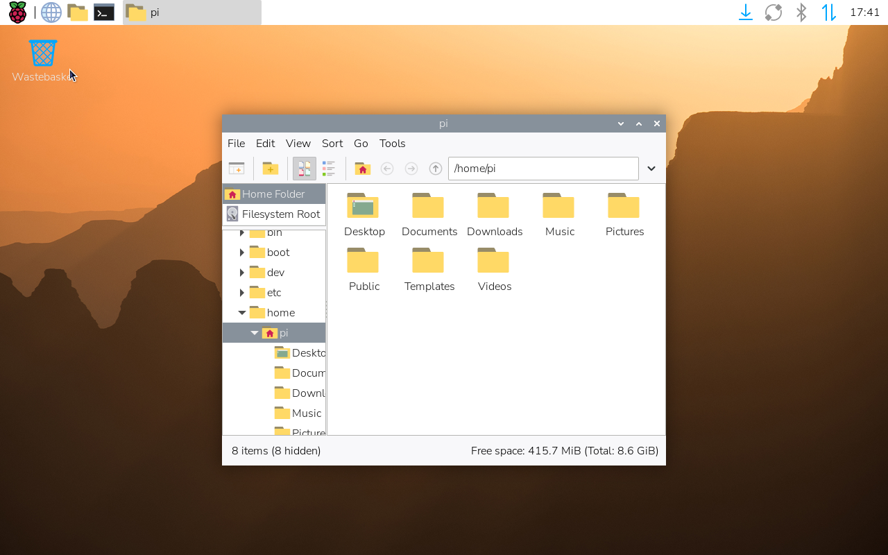
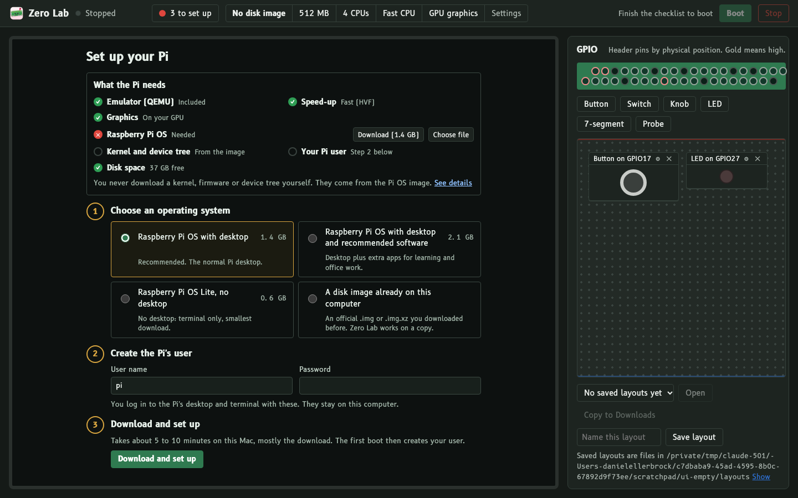

# qemu-raspi-zero2w

A QEMU fork that runs a **Raspberry Pi Zero 2 W** (the `raspi3ap` machine) fast enough to use, with GPIO you can drive from outside.
It's the emulator inside [Zero Lab](https://github.com/dsellerbrock/zero-lab) ([download page](https://pisim.ellerbrock.dev)).

The fork is branch `raspi-zero2w`, based on QEMU v11.1.0. Upstream QEMU's own README is [README.rst](README.rst).



## What this fork adds

- **GPIO edge events.** BCM2835 GPIO interrupts are modelled, and pins can be driven and observed through QTest, so a host app can be the Pi's buttons and LEDs.
- **Apple Silicon speed (HVF).** The Pi's Cortex-A53 cores run on the Mac's own cores. A 4 KiB IPA granule lets Venus GPU blobs be mapped under HVF.
- **Host GPU graphics.**
  - Venus (Vulkan → Metal via MoltenVK) and virgl (OpenGL), on virtio-gpu over virtio-mmio;
  - a GL-free Venus path;
  - Cocoa selects the Venus desktop console.
- **Fast storage.** A second virtio-mmio transport carries a virtio-blk root disk, which the SD-card emulation can't match.
- **VC4/V3D model.** The Pi's own GPU, enough for Mesa's vc4 driver:
  - control lists, binning and the tile buffer;
  - a QPU shader core;
  - optional wgpu-native shader acceleration.
  It is functional, not fast; use Venus for a smooth desktop.
- **Other BCM2835 pieces:** the HVS/pixelvalve display path, HDMI EDID, power-domain tags, and I2C receive-FIFO interrupts. There are QTests for GPIO, SDHOST and V3D.

## Speed

Raspberry Pi OS (desktop) on an Apple Silicon Mac, with a virtio-blk root:

| Mode | Desktop ready | Open a terminal | Boing |
|---|---|---|---|
| HVF + Venus | 10.3 s | 0.71 s | 57 FPS |
| HVF + software GL | 12.0 s | 0.72 s | 57 FPS |
| Before this work (SD root, HVF) | ~200 s | 93.6 s | — |

Without HVF, for example on a PC, the CPU is emulated by TCG: everything works, but booting takes 2–3 minutes.

## Build (macOS, Apple Silicon)

```bash
# virglrenderer with Venus first (see Zero Lab's mac/build-bundle.sh for a pinned, reproducible build)
./configure --target-list=aarch64-softmmu -Dvirglrenderer=enabled -Dsdl=enabled -Dgtk=disabled -Dpvg=disabled
ninja -C build qemu-system-aarch64
```

The easy way to run it, with VM settings, Boot/Stop, a GPIO sandbox and drop-in code, is [Zero Lab](https://github.com/dsellerbrock/zero-lab):



## License

GPL-2.0, like QEMU (see [COPYING](COPYING)). Raspberry Pi is a trademark of Raspberry Pi Ltd; this project is not affiliated with it.
